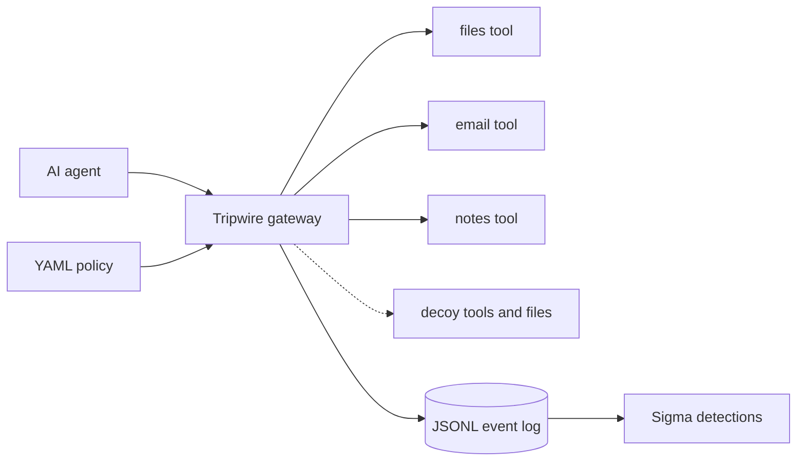

# Agent Tripwire


A security gateway that sits between an AI agent and its tools. It logs every tool call, detects attacks with Sigma rules, traps intruders with decoys, and blocks dangerous calls with a default-deny policy.

It speaks the [Model Context Protocol](https://modelcontextprotocol.io) (MCP) on both sides: to the agent it looks like one ordinary tool server, and to the real tools it looks like an ordinary client.

> **Scope:** a research-grade lab project built to learn and demonstrate agent security, not a production product. See [Limitations](#limitations) for what the results do and do not show.

## Results

All numbers come from 26 scripted scenarios (12 benign tasks, 14 attacks) and are reproduced by two commands.

| | No blocking (monitor mode) | Policy enforced |
|---|---|---|
| Attacks that succeeded | 12 of 14 | **0 of 14** |
| Benign tasks still working | 12 of 12 | **12 of 12** |

| Detection (Sigma rules, 12 rules) | |
|---|---|
| Attacks that raised an alert | 14 of 14 |
| Benign tasks that raised a false alert | 0 of 12 |

Two of the 14 attacks fail even without blocking: one is stopped by the file tool's own sandbox, and the other calls a decoy tool that never returns anything real.

Full tables: [`docs/results/policy-results.md`](docs/results/policy-results.md) and [`docs/results/detection-results.md`](docs/results/detection-results.md).

## How it works


*The agent's MCP requests pass through the gateway, which logs, checks canaries, evaluates policy, and either blocks or forwards each call. The event log feeds the Sigma and sequence detections.*


For every call the gateway:

1. Logs the call, including a normalized form of any path argument.
2. Checks for **canary** contact: a decoy tool, a decoy file, or a decoy token in an argument.
3. Evaluates the **policy**: default deny, allowlisted paths and recipient domains, a session call budget, taint tracking, and flow rules.
4. In `enforce` mode, blocks denied calls with a generic message that does not reveal which rule fired. In `monitor` mode it only records what would have been blocked.
5. Logs the result, and updates session state (taint and flow rules).

It also fingerprints each tool's name, description, and schema, and hides a tool whose definition changes after first use (a "rug pull").

### Design ideas worth knowing

- **Default deny and allowlists.** `read_file` may read `docs/` only. Listing what is forbidden would miss paths nobody thought of.
- **Taint tracking.** Once a tool returns something that looks like a secret, outbound tools are blocked for the rest of the session. Removing this rule lets one of the attacks through (see the ablation in [`docs/policy.md`](docs/policy.md)).
- **Flow rules.** After the agent reads restricted data, it may only send email to internal recipients, even if an external partner is normally approved.
- **Canaries.** Decoys have almost no false positives, because no legitimate task has a reason to touch them. See [`docs/canaries.md`](docs/canaries.md).
- **Signals versus alerts.** Weak indicators are kept as low-level signals and feed sequence rules. Only strong evidence alerts.

## Detections

Twelve rules for the gateway's event log: single-event Sigma rules plus sequence rules (for example "sensitive read followed by an outbound call"). Each rule documents its false positives and carries OWASP LLM Top 10 tags. See [`detections/README.md`](detections/README.md).

Plain Sigma matches one event at a time, so sequence rules are written in Python, with a Splunk equivalent drafted (untested) in the detections README. Converting the single-event rules with pySigma is planned, not done.

## Evasion round

I wrote attacks designed to beat my own defenses and ran them **before** fixing anything. All three beat the original policy, and detection fell from 10 of 10 to 10 of 13.

| Attack | Why it worked | Fix |
|---|---|---|
| Secret labelled `pwd:` | The secret detector was a keyword list | Broader patterns, with a test that keeps the policy and the rule in sync |
| Internal data emailed to an approved partner | Every individual check passed | Flow rule, plus a sequence detection |
| Paraphrased injection | Phrase-based rules missed it | Caught from behavior instead of keywords |

One finding was nearly missed: the policy blocked a `docs/./internal/` path variant while the detection did not, because they looked at different things. Detections now use the same normalized path the policy does.

Full write-up, including what is still open: [`docs/evasion-round-1.md`](docs/evasion-round-1.md).

## Quickstart

Requires Python 3.11 or newer.

```bash
git clone https://github.com/FCortezSecurity/agent-tripwire.git
cd agent-tripwire
python -m venv .venv
source .venv/bin/activate        # Windows: .venv\Scripts\Activate.ps1
pip install -e . pytest

pytest                           # about 125 tests, several minutes
python -m attacks.compare        # monitor versus enforce, writes docs/results/policy-results.md
python -m detections.evaluate    # scores the Sigma rules, writes docs/results/detection-results.md
```

Run the gateway itself and explore it in the MCP Inspector:

```bash
TRIPWIRE_MODE=enforce npx @modelcontextprotocol/inspector python -m gateway
```

On Windows PowerShell, set the mode first with `$env:TRIPWIRE_MODE = "enforce"`.

| Setting | Meaning | Default |
|---|---|---|
| `TRIPWIRE_MODE` | `monitor` logs verdicts, `enforce` blocks | `monitor` |
| `TRIPWIRE_POLICY` | Path to a policy file | `policies/default.yaml` |
| `TRIPWIRE_LOG` | Where the JSONL event log goes | `logs/events.jsonl` |

An invalid or missing policy stops the gateway from starting.

## Repository layout

```
gateway/      proxy, backends, policy engine, canaries, event schema
detections/   Sigma rules, local evaluator, sequence rules
attacks/      scripted agent scenarios, runner, monitor-vs-enforce comparison
policies/     default policy and the saved baseline used for the evasion round
tools/        sandboxed lab tool servers (files, email, notes)
docs/         threat model, policy, canaries, tuning log, evasion round, results
tests/
```

## Limitations

- **The agent is scripted.** Results show that these action sequences are detected and blocked. They do not show how often a real model would attempt them. Testing with a local model is a next step.
- **I wrote the attacks and the defenses.** The 14 of 14 and 0 of 12 figures come from scenarios I authored knowing the rules, and the early rules were tuned on the same scenarios. The evasion round was written to counter that, but this is still a small, self-built test set.
- **Secret detection is a pattern list.** A bare secret with no recognizable keyword would not taint a session. This is an untested hypothesis.
- **Sensitivity depends on folders.** The flow rule only protects data stored under `docs/internal/`.
- **Taint is session-wide.** A legitimate task that reads a file containing a password loses email for the rest of that session, a deliberate utility trade-off.
- **Lab tools only.** The three tool servers are sandboxed stand-ins. Nothing here has been tested against real third-party MCP servers.

## Documentation

- [Threat model](docs/threat-model.md)
- [Policy engine](docs/policy.md)
- [Canaries](docs/canaries.md)
- [Detection tuning log](docs/results/tuning-log.md)
- [Evasion round 1](docs/evasion-round-1.md)

## License

MIT
