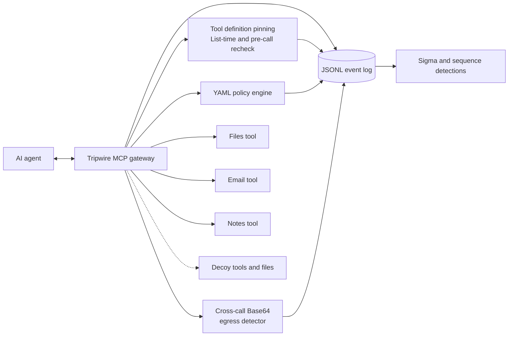

# Agent Tripwire


A security gateway that sits between an AI agent and its tools. It logs tool calls, detects attacks with Sigma and sequence rules, traps suspicious behavior with decoys, and blocks disallowed calls with a default-deny policy.

It speaks the [Model Context Protocol](https://modelcontextprotocol.io) (MCP) on both sides: to the agent it looks like one ordinary tool server, and to the real tools it looks like an ordinary client.

> **Scope:** A research-grade lab project built to learn and demonstrate agent security, not a production product. See [Limitations](#limitations) for what the results do and do not show.

## Results

The policy comparison uses 26 scripted scenarios (12 benign tasks, 14 attacks).

| | Monitor mode | Enforce mode |
|---|---:|---:|
| Attacks that succeeded | 12 of 14 | **0 of 14** |
| Benign tasks still working | 12 of 12 | **12 of 12** |

| Detection evaluation (12 Sigma rules) | Result |
|---|---:|
| Attacks that raised an alert | 14 of 14 |
| Benign tasks that raised a false alert | 0 of 12 |

Two attacks fail even without blocking: one is stopped by the file tool's own sandbox, and the other calls a decoy tool that never returns anything real.

These figures come from the scripted evaluation, not from testing against real-world agents. The policy and detection results are separate from the unit tests for the gateway's newer defenses.

Full tables: [`docs/results/policy-results.md`](docs/results/policy-results.md) and [`docs/results/detection-results.md`](docs/results/detection-results.md).

## How it works


The gateway checks tool definitions before calls, evaluates policy, inspects relevant outbound content, and logs decisions and results. The event log feeds Sigma and sequence detections.



For each tool call, the gateway:

1. Logs the call, including a normalized form of any path argument.
2. Checks for **canary** contact: a decoy tool, a decoy file, or a decoy token in an argument.
3. Rechecks the pinned tool definition when pinning is enabled, helping detect a changed tool interface even if the client has not listed tools again.
4. Evaluates the **policy**: default deny, allowlisted paths and recipient domains, a session call budget, taint tracking, and flow rules.
5. Checks eligible outbound email content against previously observed tokens using the cross-call Base64 detector.
6. In `enforce` mode, blocks denied calls with a generic message that does not reveal which rule fired. In `monitor` mode, records policy and detector decisions without blocking calls solely because of those decisions.
7. Logs results and updates relevant session state.

If a pinned tool definition changes, the gateway records the change. In enforce mode, the changed tool is blocked pending re-approval. The recheck also fails closed if verification itself raises an error.

### Design ideas worth knowing

- **Default deny and allowlists.** `read_file` may read `docs/` only. Listing what is forbidden would miss paths nobody thought of.
- **Tool definition pinning.** The gateway fingerprints each tool's name, description, and schema. It checks the definition when tools are listed and again before a call, helping catch interface changes after initial observation.
- **Taint tracking.** Once a tool returns something that looks like a secret, outbound tools are restricted for the rest of the session. See the ablation in [`docs/policy.md`](docs/policy.md).
- **Flow rules.** After the agent reads restricted data, it may only send email to internal recipients, even if an external partner is normally approved.
- **Cross-call Base64 egress detection.** The gateway keeps bounded fingerprints of token-like strings observed in successful tool results and checks eligible Base64 email content across successive calls to the same recipient. In enforce mode, a detected match can block the outbound call; monitor mode logs the suspected match.
- **Canaries.** Decoys have almost no false positives because legitimate tasks have no reason to touch them. See [`docs/canaries.md`](docs/canaries.md).
- **Signals versus alerts.** Weak indicators are kept as low-level signals and feed sequence rules. Only strong evidence alerts.

## Detections

Twelve rules analyze the gateway's event log: single-event Sigma rules plus sequence rules, such as a sensitive read followed by an outbound call. Each rule documents its false positives and carries OWASP LLM Top 10 tags. See [`detections/README.md`](detections/README.md).

Plain Sigma matches one event at a time, so sequence rules are written in Python, with a Splunk equivalent drafted but untested in the detections README. Converting the single-event rules with pySigma is planned, not done.

## Evasion round

I wrote attacks designed to beat my own defenses and ran them **before** fixing anything. All three beat the original policy, and detection fell from 10 of 10 to 10 of 13.

| Attack | Why it worked | Fix |
|---|---|---|
| Secret labelled `pwd:` | The secret detector was a keyword list | Broader patterns, with a test that keeps the policy and rule in sync |
| Internal data emailed to an approved partner | Every individual check passed | Flow rule, plus a sequence detection |
| Paraphrased injection | Phrase-based rules missed it | Detect behavior instead of relying only on keywords |

One finding was nearly missed: the policy blocked a `docs/./internal/` path variant while the detection did not, because they looked at different things. Detections now use the same normalized path as the policy.

Full write-up, including open issues: [`docs/evasion-round-1.md`](docs/evasion-round-1.md).

## Community feedback

Two of the latest improvements came out of feedback on LinkedIn. One prompted me to recheck pinned tool definitions before every call, rather than relying only on the client listing tools again. Another helped push the work on detecting Base64-encoded tokens split across successive outbound email calls.

I appreciate people taking the time to question the design and point out edge cases. This project gets stronger by testing those suggestions, documenting what changed, and being clear about what the defenses still don't cover.

## Cross-call egress testing

The Base64 detector has focused unit and integration tests for:

- A token split across successive outbound email calls.
- Enforce mode blocking a matching final fragment before backend execution.
- Monitor mode logging a suspected match while allowing the call.
- Recipient separation, unrelated Base64 content, malformed input, and bounded detector state.

A separate probe tested one synthetic token across **28 fixed chunk sizes**. The detector caught the token in all 28 cases. This is a narrow test of that token and those chunking patterns, not a general detection-rate measurement.

## Quickstart

Requires Python 3.11 or newer.

```bash
git clone https://github.com/FCortezSecurity/agent-tripwire.git
cd agent-tripwire
python -m venv .venv
source .venv/bin/activate        # Windows: .venv\Scripts\Activate.ps1
pip install -e . pytest

pytest                           # 136 tests; several minutes
python -m attacks.compare        # monitor vs enforce; updates policy results
python -m detections.evaluate    # evaluates detection rules
```

On Windows, if `python` points to an interpreter outside the virtual environment, invoke `.venv\Scripts\python.exe` explicitly.

Run the gateway and explore it in MCP Inspector:

```bash
TRIPWIRE_MODE=enforce npx @modelcontextprotocol/inspector python -m gateway
```

On Windows PowerShell, set the mode first:

```powershell
$env:TRIPWIRE_MODE = "enforce"
npx @modelcontextprotocol/inspector python -m gateway
```

| Setting | Meaning | Default |
|---|---|---|
| `TRIPWIRE_MODE` | `monitor` logs verdicts; `enforce` blocks denied calls | `monitor` |
| `TRIPWIRE_POLICY` | Path to a policy file | `policies/default.yaml` |
| `TRIPWIRE_LOG` | Where the JSONL event log goes | `logs/events.jsonl` |

An invalid or missing policy stops the gateway from starting.

## Repository layout

```text
gateway/      proxy, backends, policy engine, canaries, egress detector, event schema
detections/   Sigma rules, local evaluator, sequence rules
attacks/      scripted agent scenarios, runner, monitor-vs-enforce comparison
policies/     default policy and saved baseline used for the evasion round
tools/        sandboxed lab tool servers (files, email, notes)
docs/         threat model, policy, canaries, tuning log, evasion round, results
tests/        unit and integration tests
```

## Limitations

- **The agent is scripted.** Results show that these action sequences are detected and blocked. They do not show how often a real model would attempt them. Testing with a local model is a next step.
- **I wrote the attacks and the defenses.** The 14-of-14 and 0-of-12 figures come from scenarios I authored knowing the rules, and early rules were tuned on the same scenarios. The evasion round was written to counter that, but this is still a small, self-built test set.
- **Secret detection is a pattern list.** A bare secret with no recognizable pattern may not taint a session.
- **Sensitivity depends on folders.** The flow rule only protects data stored under `docs/internal/`.
- **Taint is session-wide.** A legitimate task that reads a file containing a password can lose email capability for the rest of that session, a deliberate utility trade-off.
- **Egress detection is targeted, not general-purpose DLP.** It looks for previously observed token-like strings in eligible Base64 email content across calls to the same recipient. It does not cover arbitrary encodings, mixed prose and encoded data, other outbound channels, or tokens the gateway has not observed. Its bounded state also limits how much history it can retain.
- **Tool pinning checks definitions, not behavior.** A backend can change what a tool does without changing its name, description, or schema. That kind of behavioral change is not detected by definition fingerprinting alone.
- **Lab tools only.** The three tool servers are sandboxed stand-ins. Nothing here has been tested against real third-party MCP servers.

## Documentation

- [Threat model](docs/threat-model.md)
- [Policy engine](docs/policy.md)
- [Canaries](docs/canaries.md)
- [Detection tuning log](docs/results/tuning-log.md)
- [Evasion round 1](docs/evasion-round-1.md)
- [Policy results](docs/results/policy-results.md)
- [Detection results](docs/results/detection-results.md)

## License

MIT
