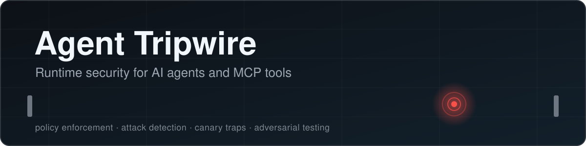
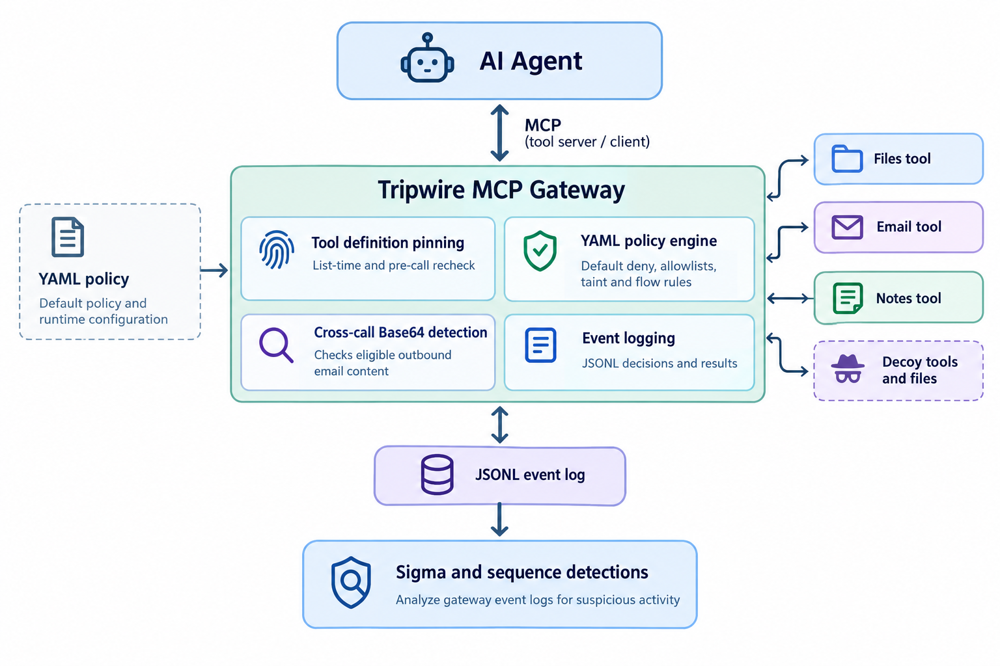
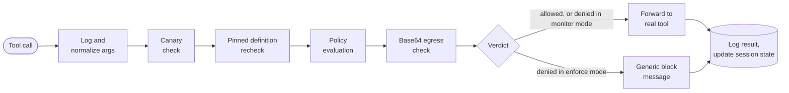

<div align="center">



<br>

[](https://github.com/FCortezSecurity/agent-tripwire/actions/workflows/ci.yml)


**A security gateway that sits between an AI agent and its tools.**<br>
It logs every call, detects attacks, traps intruders with decoys, and blocks what policy forbids.

[Results](#results) · [How it works](#how-it-works) · [Detections](#detections) · [Evasion round](#evasion-round) · [Quickstart](#quickstart) · [Limitations](#limitations) · [Roadmap](#roadmap)

</div>

<br>

## Why this exists

AI agents read files, web pages, and emails, then act on what they read. An attacker can hide instructions in that content (prompt injection) and steer the agent into misusing its tools, for example reading a secret and emailing it to an outside address. Nobody has fully solved prompt injection, so Agent Tripwire does not try to stop the model from being fooled. It watches and controls what the agent does with its tools.

It speaks the [Model Context Protocol](https://modelcontextprotocol.io) (MCP) on both sides. To the agent it looks like one ordinary tool server, and to the real tools it looks like an ordinary client.

> [!NOTE]
> This is a research-grade lab project built to learn and demonstrate agent security, not a production product. See [Limitations](#limitations) for what the results do and do not show.

## Results

The policy comparison uses 26 scripted scenarios: 12 benign tasks and 14 attacks.

| | Monitor mode (log only) | Enforce mode (block) |
|---|:---:|:---:|
| Attacks that succeeded | 12 of 14 | **0 of 14** |
| Benign tasks still working | 12 of 12 | **12 of 12** |

| Detection evaluation (12 rules) | Result |
|---|:---:|
| Attacks that raised an alert | **14 of 14** |
| Benign tasks that raised a false alert | **0 of 12** |

Two attacks fail even in monitor mode: one is stopped by the file tool's own sandbox, and the other calls a decoy tool that never returns anything real.

Both comparisons are regenerated by CI on Linux on every push to `main`. Full tables: [policy results](docs/results/policy-results.md) and [detection results](docs/results/detection-results.md).

**Latency:** the gateway adds about 10 ms per tool call on a local setup (12.7 ms median through the gateway versus 2.3 ms direct), and enforce mode costs the same as monitor mode. Details and caveats: [latency results](docs/results/latency-results.md).

> [!IMPORTANT]
> These figures come from a scripted agent running scenarios I wrote, not from real models or real-world attackers. The policy and detection results are separate from the unit tests for the gateway's newer defenses.

## How it works

<p align="center">
  
</p>

The gateway sits in the path of every tool call. Policy, detectors, and decoys act on the call, and everything lands in a JSONL event log that the Sigma and sequence detections read.

**What happens to each call:**



In `enforce` mode a denied call gets a generic message that does not reveal which rule fired. In `monitor` mode the verdict is recorded and the call goes through. If a pinned tool definition changes, the gateway records it, and in enforce mode blocks that tool pending re-approval. The recheck fails closed if verification itself errors.

### Design ideas worth knowing

| Idea | What it does |
|---|---|
| **Default deny and allowlists** | `read_file` may read `docs/` only. Listing what is forbidden would miss paths nobody thought of. |
| **Tool definition pinning** | Fingerprints each tool's name, description, and schema, and rechecks at list time and again before every call, so a "rug pull" is caught even if the client never lists tools again. |
| **Taint tracking** | Once a tool returns something that looks like a secret, outbound tools are restricted for the rest of the session. The ablation is in [`docs/policy.md`](docs/policy.md). |
| **Flow rules** | After the agent reads restricted data, email may only go to internal recipients, even if an external partner is normally approved. |
| **Cross-call Base64 egress detection** | Catches a secret split into Base64 fragments across successive emails to the same recipient. Details and gaps: [`docs/egress-detection.md`](docs/egress-detection.md). |
| **Canaries** | Decoy tools, files, and tokens that no legitimate task has a reason to touch, so alerts have almost no false positives. See [`docs/canaries.md`](docs/canaries.md). |
| **Signals versus alerts** | Weak indicators stay as low-level signals that feed sequence rules. Only strong evidence raises an alert. |

## Detections

Twelve rules analyze the gateway's event log: single-event Sigma rules plus sequence rules, such as a sensitive read followed by an outbound call. Each rule documents its false positives and carries OWASP LLM Top 10 tags. See [`detections/README.md`](detections/README.md).

| Status | Item |
|---|---|
| Done | Single-event Sigma rules, evaluated by a local evaluator |
| Done | Sequence rules, written in Python |
| Drafted, untested | Splunk equivalent of the sequence rules |
| Planned | Converting the single-event rules with pySigma |

Plain Sigma matches one event at a time, which is why the sequence rules live in Python.

## Evasion round

I wrote attacks designed to beat my own defenses and ran them **before** fixing anything. All three beat the original policy, and detection fell from 10 of 10 attacks to 10 of 13.

| Attack | Why it worked | Fix |
|---|---|---|
| Secret labelled `pwd:` | The secret detector was a keyword list | Broader patterns, plus a test that keeps the policy and the rule in sync |
| Internal data emailed to an approved partner | Every individual check passed | Flow rule, plus a sequence detection |
| Paraphrased injection | Phrase-based rules missed it | Detect behavior instead of relying only on keywords |

One finding was nearly missed: the policy blocked a `docs/./internal/` path variant while the detection did not, because they looked at different things. Detections now use the same normalized path the policy does.

Full write-up, including what is still open: [`docs/evasion-round-1.md`](docs/evasion-round-1.md).

## Quickstart

Requires Python 3.11 or newer.

```bash
git clone https://github.com/FCortezSecurity/agent-tripwire.git
cd agent-tripwire
python -m venv .venv
source .venv/bin/activate        # Windows: .venv\Scripts\Activate.ps1
pip install -e ".[dev]"

pytest                           # 136 tests, roughly 4 to 5 minutes
python -m attacks.compare        # monitor vs enforce, writes docs/results/policy-results.md
python -m detections.evaluate    # scores the rules, writes docs/results/detection-results.md
```

Run the gateway and explore it in the MCP Inspector:

```bash
TRIPWIRE_MODE=enforce npx @modelcontextprotocol/inspector python -m gateway
```

On Windows PowerShell, set the mode first:

```powershell
$env:TRIPWIRE_MODE = "enforce"
npx @modelcontextprotocol/inspector python -m gateway
```

| Setting | Meaning | Default |
|---|---|---|
| `TRIPWIRE_MODE` | `monitor` logs verdicts, `enforce` blocks denied calls | `monitor` |
| `TRIPWIRE_POLICY` | Path to a policy file | `policies/default.yaml` |
| `TRIPWIRE_LOG` | Where the JSONL event log goes | `logs/events.jsonl` |

An invalid or missing policy stops the gateway from starting.

## Repository layout

```text
gateway/      proxy, backends, policy engine, canaries, egress detector, event schema
detections/   Sigma rules, local evaluator, sequence rules
attacks/      scripted agent scenarios, runner, monitor-vs-enforce comparison
policies/     default policy and the saved baseline used for the evasion round
tools/        sandboxed lab tool servers (files, email, notes)
benchmarks/   latency benchmark: direct tool call vs through the gateway
docs/         threat model, policy, canaries, egress detection, tuning log, results
tests/        unit and integration tests
```

## Development

CI runs lint (`ruff`) and the test suite on every push and pull request, then regenerates the policy and detection results on `main`. Locally, a pre-commit config runs `ruff` and scans for hardcoded secrets with Gitleaks.

```bash
pip install -e ".[dev]"
pre-commit install
ruff check .
```

## Limitations

- **The agent is scripted.** Results show that these action sequences are detected and blocked. They do not show how often a real model would attempt them.
- **I wrote the attacks and the defenses.** The 14 of 14 alerts and 0 of 12 false alerts come from scenarios I authored knowing the rules, and early rules were tuned on the same scenarios. The evasion round was written to counter that, but this is still a small, self-built test set.
- **Secret detection is a pattern list.** A bare secret with no recognizable pattern may not taint a session.
- **Sensitivity depends on folders.** The flow rule only protects data stored under `docs/internal/`.
- **Taint is session-wide.** A legitimate task that reads a file containing a password can lose email for the rest of that session, a deliberate utility trade-off.
- **Egress detection is targeted, not general-purpose DLP.** It covers Base64 email content across successive calls to one recipient, and has known gaps (other encodings, other channels, alternating recipients). See [`docs/egress-detection.md`](docs/egress-detection.md).
- **Tool pinning checks definitions, not behavior.** A backend can change what a tool does without changing its name, description, or schema, and that is not detected.
- **Lab tools only.** The three tool servers are sandboxed stand-ins. Nothing here has been tested against real third-party MCP servers.

## Roadmap

- [ ] Run a local model as the agent and report results in a separate table from the scripted ones
- [ ] Run the attacks from [`mcp-security-lab`](https://github.com/FCortezSecurity/mcp-security-lab) through the gateway and publish hits and misses
- [ ] Convert the single-event rules with pySigma, and test a Splunk conversion
- [x] Measure the gateway's latency overhead per tool call (about 10 ms, see [latency results](docs/results/latency-results.md))

## Documentation

[Threat model](docs/threat-model.md) · [Policy engine](docs/policy.md) · [Canaries](docs/canaries.md) · [Egress detection](docs/egress-detection.md) · [Detection tuning log](docs/results/tuning-log.md) · [Evasion round 1](docs/evasion-round-1.md) · [Policy results](docs/results/policy-results.md) · [Detection results](docs/results/detection-results.md) · [Latency results](docs/results/latency-results.md)

## Acknowledgments

Two improvements came from feedback on LinkedIn: rechecking pinned tool definitions before every call, and detecting Base64 tokens split across successive emails. Thanks to everyone who questioned the design.

## License

[MIT](LICENSE)
